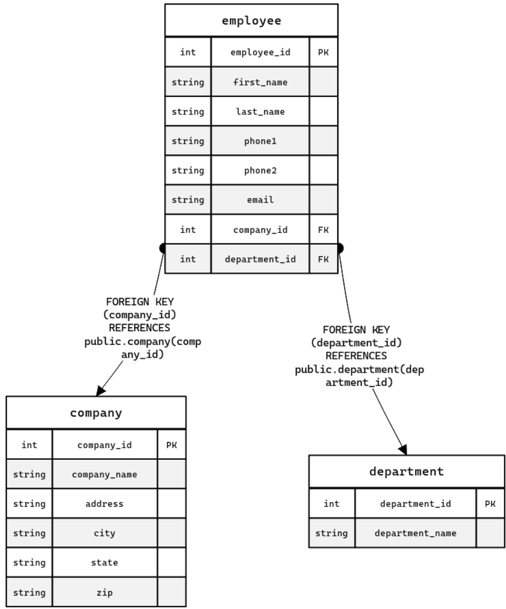

# XFAL — Company Data Platform Portfolio

Portfolio project by **Fabian Suarez** demonstrating end-to-end data engineering and backend skills: relational modeling, ETL, a CRUD REST API, Docker, and API testing.

Inspired by technical assessments that combine SQL + ETL + API delivery in one reproducible stack.

## What this project shows

| Area | Deliverable |
|------|-------------|
| Data modeling | Snowflake-style ER for Company → Department → Employee |
| DDL | PostgreSQL create scripts + schema change examples |
| ETL | CSV → normalized tables → PostgreSQL (local / remote) |
| API | Flask REST CRUD for companies, departments, employees |
| Containers | Docker Compose (Postgres + API) |
| Testing | Postman collection for all CRUD operations |

## Architecture

```
Data/Data.csv
      │
      ▼
 ETL_process/  ──►  PostgreSQL (company, department, employee)
      │                      │
      │                      ▼
      └──────────────►  API/ (Flask CRUD)
                              │
                              ▼
                     Postman collection
```



## Project structure

```
xfal/
├── API/                          # Flask CRUD API
├── Data/                         # Source CSV for ETL
├── DDL_SQL_scripts/              # Schema + ALTER examples
├── Dockerfiles/                  # Compose stack
├── ETL_process/                  # Load CSV into Postgres
├── postman_collection_crud/      # API test collection
├── .env.example
└── README.md
```

## Quick start (Docker)

1. Copy environment defaults:

```bash
cp .env.example .env
```

2. From the repo root:

```bash
docker compose -f Dockerfiles/docker-compose.yml up --build
```

3. API: `http://localhost:5000/health`  
   Postgres: `localhost:5432` (user/password from `.env`)

4. Load sample data (optional, with Python deps installed):

```bash
pip install -r API/requirements.txt -r ETL_process/requirements.txt
python ETL_process/etl_local.py
```

5. Import `postman_collection_crud/XFAL_API_CRUD.postman_collection.json` into Postman.

## API endpoints

| Method | Path | Description |
|--------|------|-------------|
| GET | `/health` | Health check |
| GET | `/data` | Dump all public tables |
| GET/POST | `/companies`, `/companies/<id>` | Company CRUD |
| PUT/DELETE | `/companies/<id>` | Update / delete company |
| GET/POST | `/departments`, `/departments/<id>` | Department CRUD |
| PUT/DELETE | `/departments/<id>` | Update / delete department |
| GET/POST | `/employees`, `/employees/<id>` | Employee CRUD |
| PUT/DELETE | `/employees/<id>` | Update / delete employee |

### Example: create a company

```bash
curl -X POST http://localhost:5000/companies \
  -H "Content-Type: application/json" \
  -d "{\"company_name\":\"Nova Labs\",\"address\":\"100 Market St\",\"city\":\"Austin\",\"state\":\"TX\",\"zip_code\":\"78701\"}"
```

## Local API without Compose

```bash
# Terminal 1 — Postgres via Docker
docker compose -f Dockerfiles/docker-compose.yml up db

# Apply schema (psql or any SQL client)
psql -h localhost -U postgres -d xfal -f DDL_SQL_scripts/main_ddl_er.sql

# Terminal 2 — API
cd API
pip install -r requirements.txt
python app.py
```

## ETL notebooks

- `ETL_process/ETL_to_DB_local.ipynb` — normalize CSV and load into local Postgres  
- `ETL_process/ETL_to_DB_remote.ipynb` — same flow against a remote Postgres (env-based)  
- `ETL_process/etl_local.py` — script version of the local pipeline  

Normalization steps:

1. Derive `company_id` from unique company address attributes  
2. Derive `department_id` from department name  
3. Build Company / Department / Employee frames  
4. Insert with `ON CONFLICT DO NOTHING`

## Schema change examples

Under `DDL_SQL_scripts/modify_or_update_schema/`:

- Add column / rename column  
- Add unique constraint / foreign key  
- Create index  
- Drop column / drop FK  

## Tech stack

- Python 3.9+, Flask, psycopg2  
- PostgreSQL  
- Pandas (ETL)  
- Docker & Docker Compose  
- Postman  

## Author

**Fabian Suarez** · [GitHub](https://github.com/fsuarez16)

Portfolio piece for data/backend roles: modeling, pipelines, APIs, and containerized delivery.
